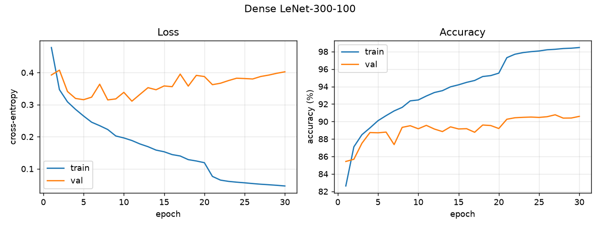
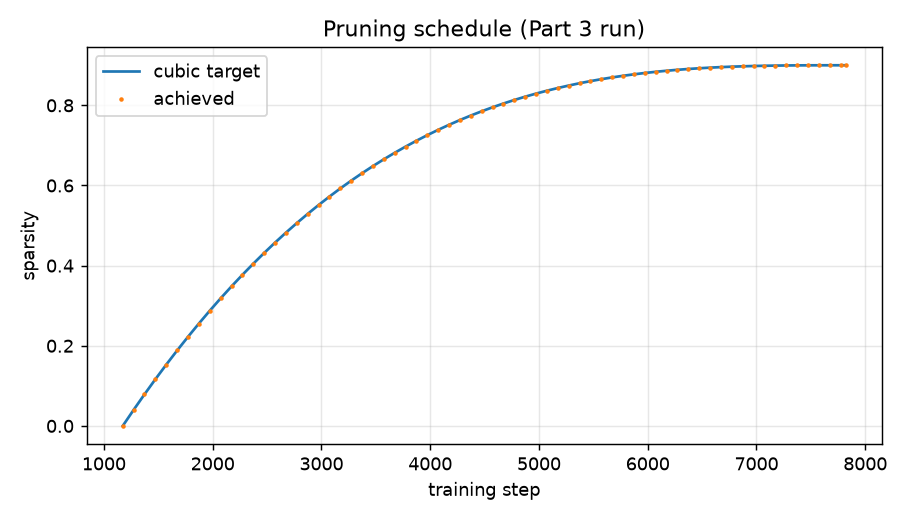
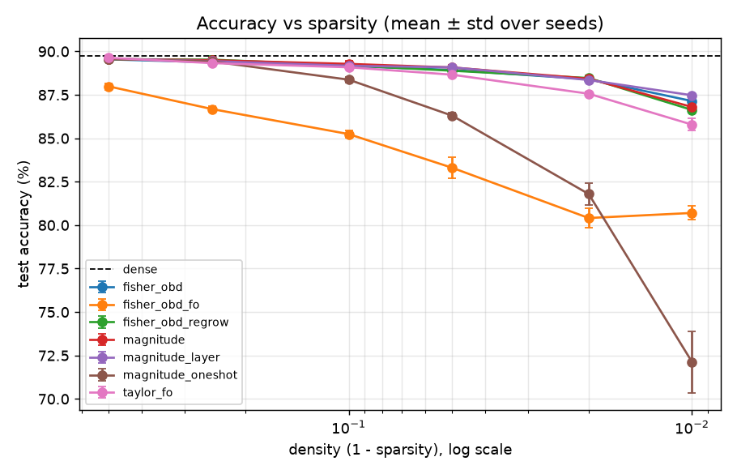
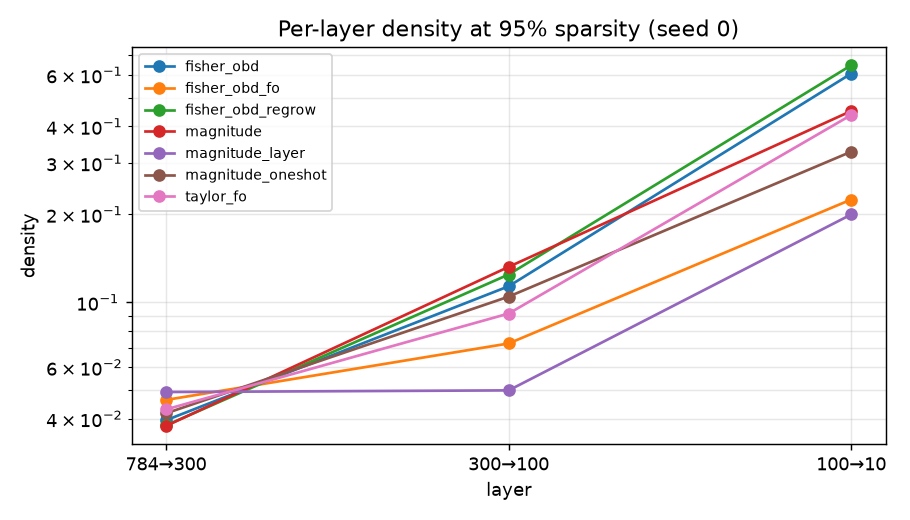
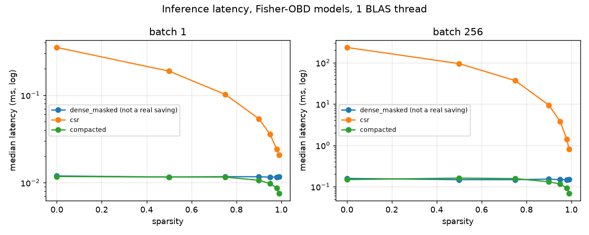

# Self-Pruning Network

A from-scratch NumPy autodiff engine trains LeNet-300-100 on Fashion-MNIST and
prunes itself during training. Weights are ranked by Optimal Brain Damage
saliency `½ v̂ w²`, with the diagonal-Fisher curvature read from Adam's second
moment, under a cubic sparsity schedule, with optional RigL-style regrowth. Masking is provably
correct: pruned weights stay exactly zero, and revived weights behave like
fresh Adam parameters.

**Headline result.** The self-pruned network keeps **89.16% test accuracy at
90% sparsity** and **88.40% at 98%**, against 89.75% dense (mean of 5 seeds,
`results/part4/sweep.csv`). It does **not** beat global magnitude pruning: the
pre-registered claim below is **not supported**. Fisher-OBD and magnitude tie at
every sparsity up to 98%; Fisher-OBD leads only at 99% (+0.34 pp). What it does
buy is structure: it removes whole hidden units, so the compacted model is
**1.6× faster at 98% sparsity, 2.1× at 99%**, where magnitude's is not
(`results/part4/bench.csv`).

> scikit-learn is used only to download Fashion-MNIST via `fetch_openml`
> (`train/data.py`). All training, gradients, models and pruning are
> implemented here in NumPy. `tests/test_no_banned_imports.py` enforces this.

## Pre-registered claim

Written and committed before the Part 4 sweep runs. `train/run_report.py`
fills in the numbers and sets `"supported"` in `results/part4/claim.json`.

> At 95% sparsity on Fashion-MNIST with LeNet-300-100, Fisher-OBD pruning
> retains X% test accuracy versus Y% for global magnitude pruning, a paired gain
> of Δ pp (95% CI [a, b]) over 10 seeds.

The claim is supported only if the CI excludes 0 in Fisher-OBD's favour. If not,
the README reports that, and at which sparsity a real gap does appear.

**Outcome (`results/part4/claim.json`): not supported.** At 95% sparsity,
Fisher-OBD retains 88.93% vs 89.08% for global magnitude, a paired difference of
**−0.14 pp** (95% bootstrap CI [−0.29, −0.01], exact sign-flip p = 0.082, Holm
p = 0.41, 10 seeds). McNemar on seed 0: 259 vs 267 discordant examples, p = 0.76.
The difference is below the noise floor: the binomial SE of a 10k test set is
0.30 pp and the dense seed-to-seed std is 0.16 pp. It is a tie, not a win.

A real gap appears only at **99%** sparsity: Fisher-OBD +0.34 pp (CI [0.19, 0.49])
over magnitude. Layerwise magnitude is better still there (+0.67 pp,
CI [0.56, 0.79]). With 5 seeds the exact permutation p cannot go below 0.0625,
so these gaps rest on the CI.

## Install

```bash
uv sync                          # Python >= 3.12, deps pinned in uv.lock
# fallback: pip install -r requirements.txt pytest
```

## Commands

| Purpose | Command | Runtime (est.) | Writes |
| --- | --- | --- | --- |
| Install | `uv sync` | 1 min | `.venv/` |
| Gradient-check tests | `uv run pytest tests/test_gradcheck.py -v` | < 30 s | — |
| All tests | `uv run pytest -v` | < 2 min | — |
| Part 2 dense training | `uv run python -m train.run_dense --seed 0` | ~1 min | `results/part2/` |
| Part 3 self-pruning run | `uv run python -m train.run_prune --method fisher_obd --sparsity 0.90 --seed 0` | ~1 min | `results/part3/` |
| Profile (DESIGN §3) | `uv run python -m train.run_profile` | < 30 s | `results/profile/` |
| Part 4 Pareto sweep | `uv run python -m train.run_sweep [--jobs N]` | ~1 h at `--jobs 6`, ~4 h at 1 | `results/part4/` |
| Part 4 quick check | `uv run python -m train.run_sweep --quick` | ~20 min | `results/part4_quick/` |
| Cost benchmark (needs the sweep's seed-0 models; `*.npz` is git-ignored) | `uv run python -m train.run_bench` | ~5 min | `results/part4/bench.csv` |
| Stats + plots | `uv run python -m train.run_report` | < 1 min | `claim.json`, `results/figures/` |

The dataset downloads on first run to `data/` (git-ignored) and is verified by
SHA-256. Quick mode writes to its own folder, so it never overwrites committed
numbers.

## Results

### Part 2: dense training



LeNet-300-100 with Adam (lr 1e-3, ×0.1 at epoch 20), batch 128, 30 epochs:
**89.76% test**, 90.59% validation (`results/part2/`). Mean over the 5 sweep
seeds is 89.75% ± 0.16. He init keeps the activation RMS at 0.99 and 0.94 through
the two ReLU layers (input 1.01). The initial loss is 3.06, not ln 10 = 2.30;
see limitations (`results/part2/init_stats.json`).

### Part 3: self-pruning



`run_prune --method fisher_obd --sparsity 0.90`: the cubic schedule prunes from
epoch 3 to 20 every 100 steps and lands on **exactly 0.900000** sparsity
(26,620 of 266,200 weights active), **89.31% test** (`results/part3/`).

### Part 4: accuracy vs sparsity



Test accuracy (%), mean over 5 seeds (10 for magnitude and Fisher-OBD at 95%):

| Method | 50% | 75% | 90% | 95% | 98% | 99% |
| --- | --- | --- | --- | --- | --- | --- |
| magnitude (global) | 89.56 | 89.49 | 89.28 | 89.08 | 88.43 | 86.80 |
| magnitude (layerwise) | 89.59 | 89.44 | 89.17 | 89.08 | 88.35 | **87.47** |
| **Fisher-OBD** | 89.54 | 89.37 | 89.16 | 88.93 | 88.40 | 87.14 |
| Fisher-OBD + regrowth | 89.55 | **89.53** | 89.19 | 88.89 | **88.47** | 86.63 |
| Taylor first-order | **89.63** | 89.33 | 89.09 | 88.66 | 87.56 | 85.79 |
| Fisher-OBD + first-order term | 87.99 | 86.68 | 85.24 | 83.30 | 80.41 | 80.70 |
| magnitude, one-shot at epoch 20 | 89.57 | 89.42 | 88.37 | 86.30 | 81.79 | 72.12 |

Dense: 89.75%. Paired differences, CIs and Holm-corrected p-values against
global magnitude for every cell: `results/part4/stats.csv`. Main findings:

- The three gradual, well-scaled criteria are statistically indistinguishable up
  to 98%.
- Gradual pruning matters far more than the criterion: one-shot loses
  2.8 pp at 95% and 14.7 pp at 99%.
- The first-order Taylor term hurts badly (DESIGN.md §1).



Fisher-OBD keeps the 1,000-weight output layer much denser (60% at 95% sparsity,
vs 45% for magnitude) and empties more hidden units. That shows up in the cost
table.

### Part 4: real cost



Median latency over 200 runs, 1 BLAS thread (Apple Accelerate, NumPy 2.5.4).
All three paths give the same logits (asserted, rtol 1e-5).

| Model | Active weights | FLOPs/example (CSR) | dense-masked b256* | CSR b256 | compacted b256 | compacted b1 |
| --- | --- | --- | --- | --- | --- | --- |
| dense | 266,200 | 532,810 | 0.148 ms | 233 ms | 0.148 ms | 0.012 ms |
| Fisher-OBD 90% | 26,620 | 53,650 | 0.152 ms | 9.39 ms | 0.131 ms | 0.011 ms |
| Fisher-OBD 95% | 13,310 | 27,030 | 0.148 ms | 3.79 ms | 0.116 ms | 0.010 ms |
| Fisher-OBD 98% | 5,324 | 11,058 | 0.147 ms | 1.40 ms | **0.093 ms** | 0.009 ms |
| Fisher-OBD 99% | 2,656 | 5,722 | 0.148 ms | 0.80 ms | **0.069 ms** | 0.008 ms |
| magnitude 98% | 5,324 | 11,058 | 0.147 ms | 1.61 ms | 0.158 ms | 0.011 ms |
| magnitude 99% | 2,655 | 5,720 | 0.148 ms | 1.00 ms | 0.125 ms | 0.009 ms |

\*Dense-masked multiplies stored zeros: it is **not a real speedup** and is shown
only as the reference. FLOPs fall about 100× at 99%, but on this machine
unstructured CSR never beats dense BLAS at any sparsity tested, even batch 1
(0.021 vs 0.012 ms at 99%). There is no crossover to report. The only real saving
is compaction (dead hidden units removed, smaller dense matrices). Fisher-OBD
produces more dead units than magnitude, so it gets 1.6× at 98% and 2.1× at 99%,
where magnitude gets 0.9× and 1.2×. Full table: `results/part4/bench.csv`.

### Engine profile

One Adam step was 80% of an epoch because of per-element `np.power` bias
correction. A lookup table made epochs 2.5× faster (DESIGN.md §3,
`results/profile/`).

## Honest limitations

- **No CSR crossover:** NumPy fancy-indexing CSR never beats Accelerate BLAS
  here, even at 99%. A compiled sparse kernel would move the crossover, but this
  repo does not have one. The dense-masked path is labelled as *not a real
  speedup* wherever latency is reported.
- **Statistical power:** 5 seeds (10 for the claim). The exact permutation test
  floor with 5 seeds is p = 0.0625, so nothing in `stats.csv` beyond the claim
  can reach p < 0.05; those comparisons rely on bootstrap CIs. After Holm
  correction, no comparison against magnitude is significant at 0.05.
- **Scope:** one dataset and one architecture.
- **Diagonal Fisher:** ignores interactions between weights removed together,
  mitigated by gradual pruning.
- **Timing:** CPU only, single BLAS thread, one machine.
- **Initial loss** at init is 3.06, not ln 10 = 2.30. Glorot on the output layer
  gives logit std 1.24, larger than "small logits" assumed. A smaller output
  init would fix it; it was left as measured.
- **Overfitting:** the dense validation loss bottoms out at epoch 11 (0.31) and
  ends at 0.40 while validation accuracy still creeps up. There is no early
  stopping or weight decay, kept identical across methods for a fair comparison.
- **Regrowth churn is high:** about 28k–64k regrown-then-dropped events per run
  (`sweep.csv`, `churn`), and regrowth gives no significant gain. The drop
  fraction α₀ = 0.3 is likely too large for this model.
- **The criterion changed from the original spec.** The planned
  `½ v̂ w² − m̂ w` underperformed magnitude by about 5 pp at 90% sparsity. The
  causes are a mis-scaled curvature (Adam's `v` is the batch-mean gradient
  squared, ≈ B× below per-example Fisher) and an invalid first-order
  extrapolation mid-training. It is kept as the ablation `fisher_obd_fo`
  (DESIGN.md §1).

## Repo map

```
engine/  autodiff Tensor, ops, fused softmax-CE, gradcheck, CSR + compaction
nn/      Module, MaskedLinear, MLP, He/Glorot init, mask-aware Adam / SGD
prune/   criteria (magnitude, Taylor-FO, Fisher-OBD, Fisher-OBD+FO), cubic schedule, Pruner, RigL regrowth
train/   data, config, loop, entry points, paired-seed stats
tests/   gradcheck, engine, masked weights, pruning, regrow, sparse, stats, repro, import guard
results/ part2, part3, part4 (sweep, stats, bench, claim, test predictions), profile, figures
```

Derivations and design answers: [DESIGN.md](DESIGN.md).
